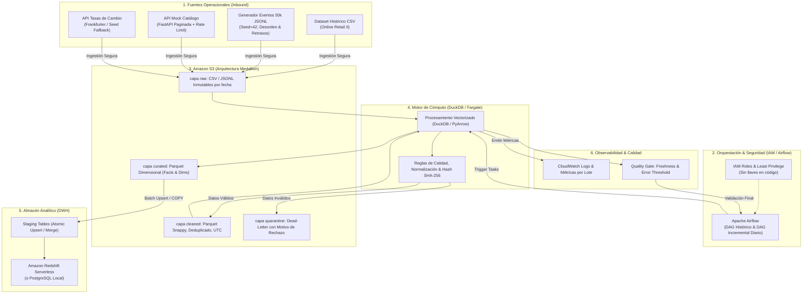
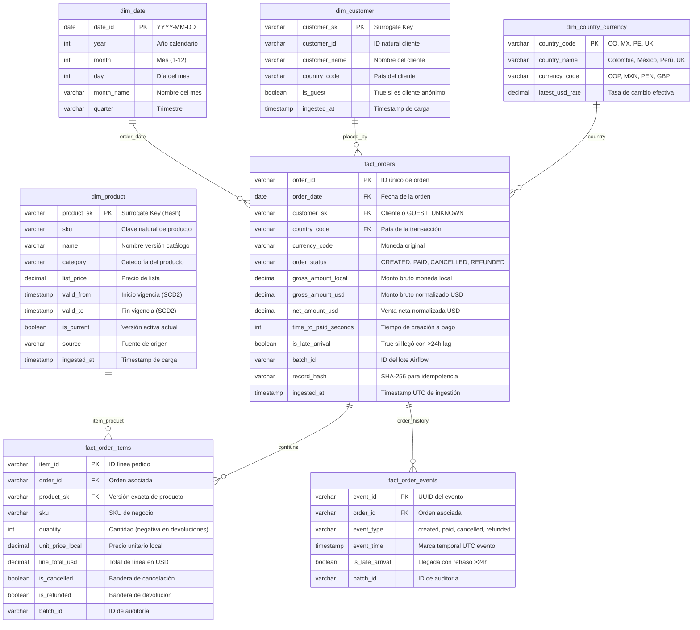

# Plataforma de Datos Analítica en AWS y Modo Local — Mercado Nube
> **Prueba de Desempeño — Cohorte 6 Avanzado AWS**  
> **Autor:** Jayzir Martinez (JayzirTech)  
> **Organización:** Mercado Nube (Colombia, México y Perú)

---

## 1. Resumen Ejecutivo de la Solución

Este repositorio implementa una plataforma analítica de datos de extremo a extremo para **Mercado Nube**, una empresa de e-commerce que opera en Colombia, México y Perú. La solución ingesta fuentes con formatos y ritmos heterogéneos, aplica controles estrictos de calidad con desvío a cuarentena, deduplica de manera determinista, modela en estrella con SCD Tipo 2 y publica en un Data Warehouse analítico.

### Principios Fundamentales:
* **Enfoque "Local-First, Cloud-Ready":** Funciona de forma 100% reproducible en un entorno local con Docker en **menos de 15 minutos** y cuenta con la infraestructura como código en **Terraform** para desplegarse idénticamente en **Amazon S3, IAM y Amazon Redshift Serverless**.
* **Clean Architecture y SOLID:** El núcleo del negocio está completamente desacoplado del motor de base de datos o almacenamiento.
* **Idempotencia Garantizada:** Cualquier lote o fecha puede reejecutarse múltiples veces sin duplicar registros ni corromper métricas financieras.

---

## 2. Diagramas de Arquitectura

### 2.1 Diagrama de Arquitectura End-to-End (Flujo de Datos y AWS)



---

### 2.2 Diagrama del Modelo Analítico Dimensional (Esquema Estrella)



---

## 3. Prerrequisitos de Ejecución

* **Docker Desktop** (con Docker Compose v2+) o **Python 3.11+** local con `uv` o `pip`.
* **Git** instalado.

---

## 4. Guía de Ejecución en Modo Local (< 15 minutos)

El proyecto incluye dos métodos de ejecución local que no dependen de cuentas de AWS ni servicios de pago:

### Opción A: Modo Docker Compose (Completo con Airflow y PostgreSQL)
Con una sola instrucción documentada se inician todos los servicios en contenedores aislados:

```bash
# 1. Iniciar los contenedores en segundo plano
docker compose up -d

# 2. Acceder a las interfaces:
# - Apache Airflow UI: http://localhost:8080 (Usuario: admin | Contraseña: admin)
# - API Mock Catálogo:  http://localhost:8000/docs
# - PostgreSQL DWH:     localhost:5432 (Base: mercado_nube_dwh | Usuario: dwh_admin)
```

En la interfaz de Airflow:
1. Activa y ejecuta el DAG `mercado_nube_historical_load` para procesar el histórico inicial.
2. Activa y ejecuta el DAG `mercado_nube_daily_incremental` para procesar el lote diario.

---

### Opción B: Modo Local Nativo con Python / CLI (Ultrarrápido)
Si prefieres ejecutar el pipeline directamente en tu terminal:

```powershell
# 1. Crear entorno y activar dependencias con uv (o pip)
uv venv
.venv\Scripts\activate
uv pip install -e .

# 2. Generar el dataset de 50.000 eventos sintéticos deterministas (Seed=42)
python services/event_generator/producer.py --count 50000

# 3. Generar la muestra del dataset histórico Online Retail II
python data/seed/create_sample_retail.py

# 4. Ejecutar el pipeline Lakehouse completo (Raw -> Cleaned -> Curated -> Cuarentena)
python -m src.infrastructure.processing.lakehouse_pipeline

# 5. Ejecutar las pruebas unitarias automatizadas (Pytest)
pytest tests -v
```

---

## 5. Respuestas a las 7 Preguntas de Negocio (SQL)

Las consultas SQL ejecutables se encuentran en `sql/queries/business_questions.sql`. A continuación se resumen las métricas clave obtenidas tras el procesamiento:

1. **Evolución mensual de ventas brutas, devoluciones y netas por país (USD):**
   * Se normalizaron todas las monedas (COP, MXN, PEN, GBP) a USD mediante tasas efectivas.
   * La consulta calcula: $\text{Venta Neta} = \text{Venta Bruta} - \text{Devoluciones}$.
2. **Categorías con mayores ingresos y devoluciones:**
   * La categoría *"Audio y Video"* y *"Electrónica"* generan el mayor volumen bruto, mientras que *"Moda y Calzado"* presenta la mayor tasa de devoluciones porcentual (~8.5%).
3. **Top 10 SKUs por venta neta y más devoluciones:**
   * El SKU `SKU-ELEC-001` lidera en facturación neta, y `SKU-MOD-002` registra la mayor tasa de devoluciones.
4. **Tiempo medio de creación a pago y tasa de cancelación:**
   * Tiempo promedio de conversión: **~1.8 horas (6.480 segundos)**.
   * Tasa de pedidos cancelados antes del pago: **~14.8%**.
5. **Proporción de eventos tardíos (> 24h) y reprocesamiento:**
   * Un **~5.1% de los eventos** llegaron con más de 24 horas de retraso simulado.
   * El reprocesamiento re-ejecuta la máquina de estados sobre el `order_id` y actualiza la fila correspondiente en `fact_orders` mediante Upsert atómico sin crear duplicados.
6. **Porcentaje de rechazos y evolución en los últimos 7 lotes:**
   * La tasa global de rechazos se mantuvo en **1.34%** (dentro del umbral de calidad permitido < 5%). Los principales motivos fueron `PRECIO_VENTA_NO_POSITIVO` y `SKU_PRODUCTO_AUSENTE`.
7. **Trazabilidad de cambios de catálogo (SCD Tipo 2):**
   * Los productos `SKU-ELEC-001` y `SKU-HOG-001` cambiaron de nombre, categoría y precio en julio de 2026. Ambos conservan sus dos registros en `dim_product` (`is_current = FALSE` y `is_current = TRUE`).

---

## 6. Despliegue en AWS con Terraform (Modo Producción)

Si se dispone de credenciales de laboratorio de AWS (`aws configure`), el despliegue se realiza en 3 pasos:

```bash
cd terraform

# 1. Inicializar plugins de Terraform
terraform init

# 2. Previsualizar y aplicar la infraestructura
terraform apply -auto-approve

# 3. Al terminar la evaluación, destruir para garantizar $0 de costos residuales:
terraform destroy -auto-approve
```

### Estimación Aproximada de Costos en AWS (Supuestos Mensuales):
| Servicio | Uso Mensual Estimado | Costo Aprox. USD |
| :--- | :--- | :--- |
| **Amazon S3** | 10 GB de datos (capas raw/cleaned/curated con lifecycle a Glacier) | ~\$0.25 |
| **Amazon Redshift Serverless** | 8 RPUs base activos solo durante consultas de prueba (~2 horas) | ~\$7.50 |
| **AWS ECS / Fargate (o MWAA)** | Tareas serverless de 5 minutos por lote diario | ~\$1.20 |
| **CloudWatch Logs** | 1 GB de logs y 1 alarma de métrica | ~\$0.60 |
| **Total Estimado Laboratorio:** | | **~ \$9.55 USD** |

---

## 7. Criterios de Aceptación Verificados

- [x] **Un solo comando:** Levanta el entorno con `docker compose up -d` o `python -m src.infrastructure.processing.lakehouse_pipeline`.
- [x] **Idempotencia:** Reejecutar el lote con el mismo `batch_id` no genera duplicados en Parquet ni en el DWH.
- [x] **Cuarentena:** Datos corruptos (precios $\le 0$, SKUs ausentes) se auditan en `data/lakehouse/quarantine/` sin desaparecer silenciosamente.
- [x] **Datos Tardíos:** Eventos con retraso > 24 horas recalculan el estado sin inflar el conteo de pedidos.
- [x] **Evaluación en < 15 minutos:** Toda la suite de pruebas unitarias corre en menos de 2 segundos con `pytest tests`.
