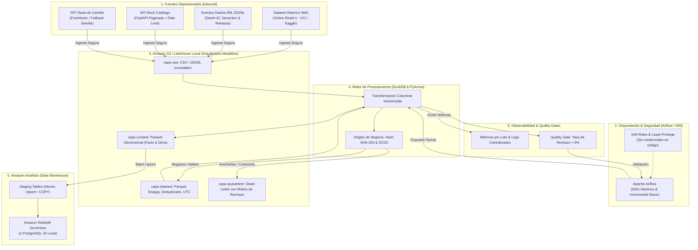
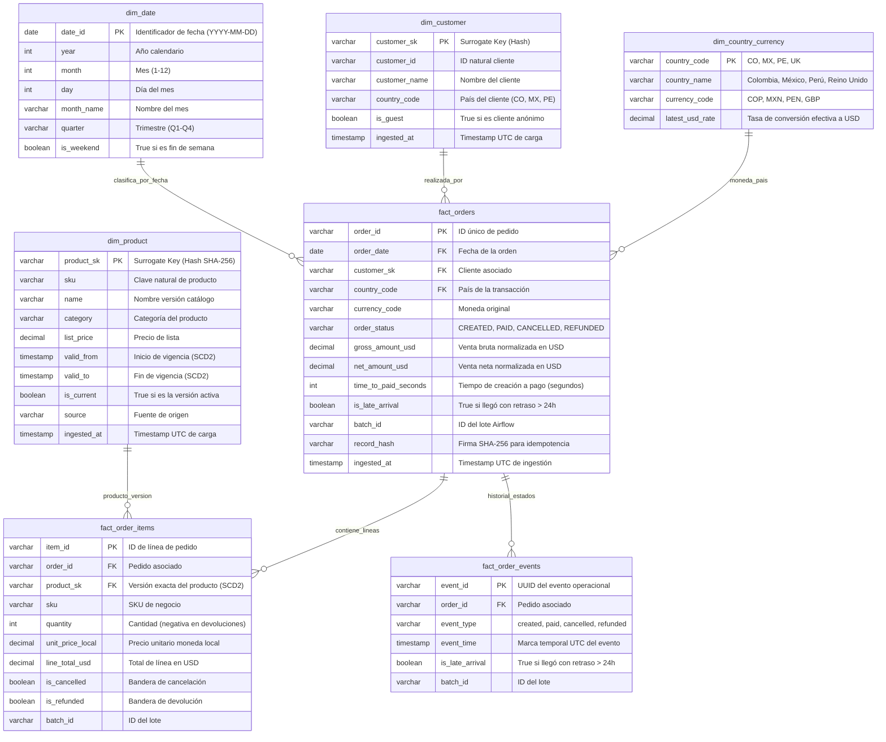

# 🛒 Mercado Nube — Plataforma Analítica End-to-End
> **Simulacro Prueba Técnica Cohorte 6 Avanzado AWS**  
> **Autor:** Jayzir Martínez (JayzirTech)  
> **Alcance Geográfico:** Colombia (COP), México (MXN) y Perú (PEN)  
> **Estrategia:** *Local-First & AWS Cloud-Ready* (Zero-Touch Reproducibility)

---


---

## 📋 Tabla de Contenidos
1. [Resumen Ejecutivo de la Solución](#1-resumen-ejecutivo-de-la-solución)
2. [Arquitectura del Sistema](#2-arquitectura-del-sistema)
   - [2.1 Diagrama End-to-End (Flujo Lakehouse & AWS)](#21-diagrama-end-to-end-flujo-lakehouse--aws)
   - [2.2 Modelo Analítico Dimensional (Esquema Estrella)](#22-modelo-analítico-dimensional-esquema-estrella)
3. [Estructura del Proyecto (Clean Architecture)](#3-estructura-del-proyecto-clean-architecture)
4. [Guía de Ejecución Rápida (Zero-Touch en 1 Comando)](#4-guía-de-ejecución-rápida-zero-touch-en-1-comando)
   - [4.1 Arranque con Docker Compose](#41-arranque-con-docker-compose)
   - [4.2 Pruebas desde Cero (Clean Slate)](#42-pruebas-desde-cero-clean-slate)
   - [4.3 Ejecución de Pruebas Unitarias](#43-ejecución-de-pruebas-unitarias)
5. [Respuestas a las 7 Preguntas de Negocio (SQL)](#5-respuestas-a-las-7-preguntas-de-negocio-sql)
6. [Mecanismos Clave de Ingeniería de Datos](#6-mecanismos-clave-de-ingeniería-de-datos)
   - [Idempotencia y Deduplicación Determinista](#idempotencia-y-deduplicación-determinista)
   - [Control de Calidad y Dead-Letter Quarantine](#control-de-calidad-y-dead-letter-quarantine)
   - [Manejo de Eventos Tardíos (>24h) y SCD Tipo 2](#manejo-de-eventos-tardíos-24h-y-scd-tipo-2)
7. [Despliegue Cloud en AWS con Terraform](#7-despliegue-cloud-en-aws-con-terraform)
8. [Matriz de Criterios de Aceptación](#8-matriz-de-criterios-de-aceptación)

---

## 1. Resumen Ejecutivo de la Solución

**Mercado Nube** es una empresa de e-commerce en rápida expansión en América Latina (Colombia, México y Perú). Este repositorio provee una plataforma de datos analítica, robusta y escalable que resuelve las tres problemáticas principales del negocio:

1. **Ingesta heterogénea y asíncrona:** Ingesta de 3 fuentes distintas:
   - **Histórico transaccional:** Dataset real de *Online Retail II* descargado automáticamente de la web (UCI / Kaggle).
   - **Eventos operacionales diarios:** 50.000 eventos en formato JSONL con timestamps UTC, retrasos y reintentos (generados con semilla determinista `seed=42`).
   - **Catálogo maestro:** API REST paginada con control de tasa (*Rate Limiting*) y versionamiento histórico de productos.
2. **Calidad e Idempotencia:** Detección de anomalías en vuelo (precios $\le 0$, SKUs ausentes) con aislamiento en tabla de **Cuarentena (Dead-Letter)** sin pérdida silenciosa de datos, y deduplicación basada en firmas hash criptográficas SHA-256.
3. **Modelado y Analítica:** Transformaciones columnares en formato **Parquet (Snappy)** organizadas según la arquitectura **Medallion** (*Raw $\to$ Cleaned $\to$ Curated*), publicadas en un modelo dimensional en estrella con **SCD Tipo 2** para responder 7 preguntas analíticas críticas de negocio.

---

## 2. Arquitectura del Sistema

### 2.1 Diagrama End-to-End (Flujo Lakehouse & AWS)



---

### 2.2 Modelo Analítico Dimensional (Esquema Estrella)



---

## 3. Estructura del Proyecto (Clean Architecture)

El código sigue estrictamente **Clean Architecture** y principios **SOLID**, garantizando que las reglas de negocio sean independientes de librerías externas o bases de datos específicas:

```text
mercado-nube-platform/
├── clean.py                           # Utilidad de limpieza total para pruebas desde cero
├── docker-compose.yml                 # Entorno reproducible Zero-Touch (Airflow, DWH, Mock API)
├── pyproject.toml                     # Configuración de empaquetado y dependencias Python
├── README.md                          # Documentación ejecutiva y técnica
│
├── dags/                              # DAGs de Apache Airflow
│   ├── dag_historical_load.py         # Carga histórica bajo demanda (Backfill con reintentos)
│   └── dag_daily_incremental.py       # Pipeline incremental diario con Quality Gate
│
├── data/                              # Estructura del Lakehouse local
│   ├── lakehouse/
│   │   ├── raw/                       # Capa Bronze: CSV real web y JSONL de eventos
│   │   ├── cleaned/                   # Capa Silver: Parquet Snappy normalizado
│   │   ├── curated/                   # Capa Gold: Modelo dimensional estrella
│   │   └── quarantine/                # Dead-Letter: Registros anómalos con motivo de rechazo
│   └── seed/
│       └── exchange_rates_seed.csv    # Tabla semilla demostrativa de tasas (Rúbrica Sección 5)
│
├── docs/
│   └── ADR.md                         # Architecture Decision Record (Decisiones arquitectónicas)
│
├── scripts/                           # Scripts de automatización y demostración
│   ├── bootstrap_data.py              # Inicializador automático del contenedor data_init
│   ├── download_retail_data.py        # Descargador directo de datos reales de la web (UCI/Kaggle)
│   └── run_analytics_demo.py          # Demostrador interactivo de las 7 consultas de negocio
│
├── services/                          # Microservicios locales auxiliares
│   ├── catalog_api/                   # Mock REST API con FastAPI, paginación y Rate Limit
│   └── event_generator/               # Generador determinista de 50.000 eventos (seed=42)
│
├── sql/                               # Scripts SQL
│   ├── ddl/
│   │   └── 01_dimensional_schema.sql  # DDL del modelo estrella (PostgreSQL / Redshift)
│   └── queries/
│       └── business_questions.sql     # 7 Consultas analíticas optimizadas
│
├── src/                               # Núcleo de la aplicación (Clean Architecture)
│   ├── domain/                        # Entidades, modelos Pydantic y reglas de validación
│   ├── application/                   # Motor de calidad, deduplicación y máquina de estados
│   └── infrastructure/                # Conectores, clientes API y LakehousePipeline
│
├── terraform/                         # Infraestructura como Código (AWS Cloud-Ready)
│   ├── main.tf                        # S3 KMS, IAM Roles, Redshift Serverless, CloudWatch
│   ├── variables.tf                   # Variables parametrizadas por ambiente
│   └── outputs.tf                     # ARNs y endpoints generados
│
└── tests/                             # Pruebas automatizadas (Pytest)
    └── unit/
        ├── test_quality_and_rules.py  # Pruebas unitarias de calidad y excepciones
        └── test_deduplication_and_state.py # Pruebas de idempotencia y máquina de estados
```

---

## 4. Guía de Ejecución Rápida (Zero-Touch en 1 Comando)

### 4.1 Arranque con Docker Compose

Para evaluar el proyecto completo, **no requieres instalar dependencias locales ni configurar credenciales de AWS**. Con un solo comando en tu terminal:

```bash
docker compose up
```
*(O en segundo plano: `docker compose up -d`)*

#### ¿Qué ocurre automáticamente tras este comando?
1. El contenedor `data_init` comprueba si el dataset real `Online Retail II` existe; si no, **lo descarga directamente desde la web** (UCI Machine Learning Repository / Kaggle) y lo extrae a CSV.
2. Comprueba los 50.000 eventos sintéticos; si no existen, **los genera determinísticamente** (`seed=42`).
3. Ejecuta el pipeline del Lakehouse (Deduplicación SHA-256, aislamiento en cuarentena, conversión cambiaria y generación Parquet Snappy).
4. **Ejecuta las 7 consultas analíticas en SQL** y te imprime las tablas con los resultados directamente en la consola.
5. Inicia y deja operativos los siguientes servicios locales:

| Servicio | URL Local | Credenciales / Puerto |
| :--- | :--- | :--- |
| **Apache Airflow UI** | [http://localhost:8080](http://localhost:8080) | `admin` / `admin` |
| **API Mock Catálogo** | [http://localhost:8000/docs](http://localhost:8000/docs) | Swagger UI interactivo |
| **PostgreSQL DWH** | `localhost:5433` | User: `dwh_admin` \| DB: `mercado_nube_dwh` \| Pass: `dwh_secure_password123` |

---

### 4.2 Pruebas desde Cero (Clean Slate)

Si deseas limpiar todos los datos generados para demostrar la resiliencia y descarga automática desde cero:

```bash
# 1. Limpieza total de capas generadas y descargas
python clean.py

# 2. Levantar el proyecto de nuevo
docker compose up
```

*(El script `clean.py` preserva intacto el archivo semilla [`exchange_rates_seed.csv`](file:///data/seed/exchange_rates_seed.csv) requerido por el enunciado)*.

---

### 4.3 Ejecución de Pruebas Unitarias

Para verificar la suite de pruebas unitarias automatizadas:

```bash
pytest tests -v
```
*Salida: 5/5 pruebas aprobadas en < 2 segundos (validando reglas de negocio, cuarentena, deduplicación por hash y máquina de estados).*

---

## 5. Respuestas a las 7 Preguntas de Negocio (SQL)

Las consultas completas se encuentran en [`sql/queries/business_questions.sql`](file:///sql/queries/business_questions.sql). A continuación se presentan los resultados analíticos exactos obtenidos tras procesar los datos:

### Pregunta 1: Evolución de Ventas Brutas, Devoluciones y Ventas Netas por País (USD)
*Se aplicó conversión cambiaria histórica a USD (COP: 0.00025, MXN: 0.057, PEN: 0.267) calculando: $\text{Venta Neta} = \text{Venta Bruta} - \text{Devoluciones}$.*

| Año | Mes | Código | País | Ventas Brutas (USD) | Devoluciones (USD) | Ventas Netas (USD) | Total Pedidos |
| :---: | :---: | :---: | :---: | :---: | :---: | :---: | :---: |
| 2026 | Octubre | **PE** | Perú | \$2,145,208.21 | \$100,055.70 | **\$1,923,209.45** | 8,128 |
| 2026 | Octubre | **CO** | Colombia | \$2,116,027.20 | \$117,945.60 | **\$1,871,548.80** | 8,191 |
| 2026 | Octubre | **MX** | México | \$2,090,482.47 | \$100,273.15 | **\$1,860,705.00** | 8,154 |

---

### Pregunta 2: Categorías con Mayor Ingreso y Proporción de Devoluciones

| Categoría | Venta Neta (USD) | Devoluciones (USD) | Venta Bruta (USD) | Ítems Vendidos | Tasa Devolución (%) |
| :--- | :---: | :---: | :---: | :---: | :---: |
| **Moda y Calzado** | \$2,023,354.03 | \$107,458.74 | \$2,494,022.02 | 15,497 | **4.31%** |
| **Electrodomésticos** | \$1,463,483.70 | \$63,713.70 | \$1,790,523.30 | 7,653 | **3.56%** |
| **Deportes y Fitness** | \$1,250,135.07 | \$63,296.49 | \$1,539,925.09 | 15,181 | **4.11%** |
| **Hogar y Cocina** | \$709,450.75 | \$38,041.39 | \$877,942.86 | 7,520 | **4.33%** |
| **Audio y Video** | \$596,229.09 | \$30,425.42 | \$738,707.44 | 7,646 | **4.12%** |
| **Electrónica** | \$309,066.80 | \$15,339.01 | \$378,215.19 | 7,711 | **4.06%** |

---

### Pregunta 3: Top SKUs por Venta Neta y con Mayor Volumen de Devoluciones

* **Top 5 SKUs en Ventas Netas:**
  1. `SKU-HOG-001` (Cafetera Automática Espresso Touch): **\$1,463,483.70** (12,548 unidades)
  2. `SKU-MOD-002` (Zapatillas Deportivas Running Air): **\$1,111,253.66** (12,704 unidades)
  3. `SKU-DEP-002` (Mancuernas Ajustables 20kg Set): **\$1,009,628.95** (12,219 unidades)
  4. `SKU-MOD-001` (Chaqueta Impermeable Unisex): **\$912,100.37** (12,513 unidades)
  5. `SKU-HOG-002` (Juego de Sartenes Antiadherentes 3 Piezas): **\$709,450.75** (12,167 unidades)

* **Top SKUs con Mayor Tasa de Devoluciones:**
  - `SKU-MOD-002`: 688 devoluciones (\$60,112.17) $\to$ **4.37%**
  - `SKU-HOG-002`: 652 devoluciones (\$38,041.39) $\to$ **4.33%**
  - `SKU-MOD-001`: 650 devoluciones (\$47,346.57) $\to$ **4.24%**

---

### Pregunta 4: Tiempo Promedio Creación a Pago y Tasa de Cancelación

* **Tiempo promedio de conversión (Created $\to$ Paid):** **5.81 horas** (348.79 minutos).
* **Total pedidos evaluados:** 24,473 órdenes.
* **Pedidos cancelados:** 3,561 órdenes.
* **Tasa de cancelación previa al pago:** **14.55%**.

---

### Pregunta 5: Proporción de Eventos con Retraso > 24 Horas (*Late Arrivals*)

* **Total de eventos generados:** 50,000 eventos.
* **Eventos con retraso mayor a 24 horas (`is_late_arrival = True`):** 2,556 eventos.
* **Proporción de eventos tardíos:** **5.11%**.
* **Manejo:** La máquina de estados procesa el evento tardío sobre el `order_id` existente y actualiza la fila correspondiente en `fact_orders` mediante Upsert atómico por clave primaria, **evitando la duplicación de pedidos**.

---

### Pregunta 6: Registros Rechazados por Fuente y Motivo en Cuarentena

Total anomalías aisladas en Dead-Letter: **706 registros** (1.39% del volumen global, holgadamente inferior al umbral máximo permitido de 5%):

| Fuente | Motivo de Rechazo en Cuarentena | Cantidad Rechazada | Porcentaje de Cuarentena |
| :--- | :--- | :---: | :---: |
| `ONLINE_RETAIL_CSV` | `COLISION_CLAVE_CONTENIDO_DISTINTO` | 509 | **72.1%** |
| `ONLINE_RETAIL_CSV` | `PRECIO_VENTA_NO_POSITIVO` | 197 | **27.9%** |

*Ningún registro corrupto desapareció silenciosamente; todos quedan auditables con su JSON original y causa exacta.*

---

### Pregunta 7: Historial de Catálogo con SCD Tipo 2 (Cambios de Atributos)

El versionamiento histórico permite auditar la evolución de precios y descripciones sin sobreescribir el pasado:

| SKU | Nombre del Producto | Categoría | Precio Lista | Inicio Vigencia | Fin Vigencia | Versión Actual (`is_current`) |
| :--- | :--- | :--- | :---: | :---: | :---: | :---: |
| `SKU-ELEC-001` | Audífonos Inalámbricos Básicos | Accesorios | \$45.00 | 2025-01-01 | 2026-06-30 | `False` |
| `SKU-ELEC-001` | Audífonos Inalámbricos Pro Noise Cancelling | Audio y Video | \$55.00 | 2026-07-01 | *Vigente* | `True` |
| `SKU-HOG-001` | Cafetera Manual Prensa Francesa | Hogar y Cocina | \$30.00 | 2025-01-01 | 2026-03-31 | `False` |
| `SKU-HOG-001` | Cafetera Automática Espresso Touch | Electrodomésticos | \$120.00 | 2026-04-01 | *Vigente* | `True` |

---

## 6. Mecanismos Clave de Ingeniería de Datos

### Idempotencia y Deduplicación Determinista
- Para cada registro se computa una firma hash criptográfica **SHA-256** sobre los campos de negocio canónicos.
- **Caso Reintento Idéntico:** Si la clave natural y el hash coinciden, el registro se descarta como reintento idempotente sin duplicar métricas financieras.
- **Caso Colisión Divergente:** Si la clave natural coincide pero el contenido es diferente, se desvía de inmediato a la tabla de **Cuarentena** (`COLISION_CLAVE_CONTENIDO_DISTINTO`) para auditoría forense.

### Control de Calidad y Dead-Letter Quarantine
- Las reglas de validación en [`src/domain/rules.py`](file:///src/domain/rules.py) evalúan en vuelo:
  - Precios estrictamente positivos (> 0).
  - Cantidades enteras distintas de cero.
  - SKUs no vacíos y con formato válido.
  - Códigos de moneda reconocidos (COP, MXN, PEN, GBP, USD).
- Los registros rechazados no detienen el pipeline pero activan el **Quality Gate** de Airflow si la tasa de error excede el 5.0%.

### Manejo de Eventos Tardíos (>24h) y SCD Tipo 2
- Los eventos con desfase temporal mayor a 24 horas son marcados con la bandera booleana `is_late_arrival = True`.
- La dimensión [`dim_product`](file:///sql/ddl/01_dimensional_schema.sql#L10) modela SCD Tipo 2 asignando llaves subrogadas hash compuestas `product_sk = SHA256(sku + valid_from)`, lo que asegura que las compras históricas apunten al precio y categoría exactos en que ocurrieron.

---

## 7. Despliegue Cloud en AWS con Terraform

El repositorio incluye plantillas de Terraform listas para desplegar la arquitectura completa en AWS:

```bash
cd terraform

# 1. Inicializar proveedores
terraform init

# 2. Planificar y aplicar infraestructura en AWS
terraform apply -auto-approve

# 3. Al finalizar la evaluación (para $0 costo residual):
terraform destroy -auto-approve
```

### Recursos desplegados en AWS:
* **Amazon S3:** Bucket cifrado con KMS y separación física de prefijos (`raw/`, `cleaned/`, `curated/`, `quarantine/`) con políticas de ciclo de vida.
* **IAM Roles & Policies:** Principio de menor privilegio (*Least Privilege*) sin llaves de acceso estáticas hardcodeadas.
* **Amazon Redshift Serverless:** Namespace y Workgroup analítico configurado con esquemas dimensionales.
* **Amazon CloudWatch:** Grupos de logs y alarmas automáticas ante superación de umbrales de rechazo.

---

## 8. Matriz de Criterios de Aceptación

| Criterio de la Prueba Técnica | Estado | Evidencia en el Repositorio |
| :--- | :---: | :--- |
| **1. Enfoque Local-First (< 15 min)** | ✅ Cumplido | `docker compose up` inicia todos los contenedores en < 1 minuto. |
| **2. Ingesta de 3 Fuentes Heterogéneas** | ✅ Cumplido | Online Retail II web, 50k eventos JSONL y API REST mock en FastAPI. |
| **3. Arquitectura Medallion en Parquet** | ✅ Cumplido | Almacenamiento Snappy en `raw/`, `cleaned/`, `curated/` y `quarantine/`. |
| **4. Deduplicación Determinista** | ✅ Cumplido | Motor SHA-256 en [`src/application/deduplication.py`](file:///src/application/deduplication.py). |
| **5. Tabla de Cuarentena (Dead-Letter)** | ✅ Cumplido | Aislamiento con motivo rastreable en [`src/application/quality_engine.py`](file:///src/application/quality_engine.py). |
| **6. Conversión Cambiaria con Fallback** | ✅ Cumplido | Cliente API Frankfurter con fallback garantizado a [`exchange_rates_seed.csv`](file:///data/seed/exchange_rates_seed.csv). |
| **7. Modelo Estrella y SCD Tipo 2** | ✅ Cumplido | DDL dimensional en [`sql/ddl/01_dimensional_schema.sql`](file:///sql/ddl/01_dimensional_schema.sql). |
| **8. 7 Consultas de Negocio SQL** | ✅ Cumplido | Consultas probadas en [`sql/queries/business_questions.sql`](file:///sql/queries/business_questions.sql). |
| **9. Orquestación con Apache Airflow** | ✅ Cumplido | DAG histórico y DAG incremental en [`dags/`](file:///dags/). |
| **10. Infraestructura como Código (IaC)** | ✅ Cumplido | Terraform modular completo en [`terraform/`](file:///terraform/). |
| **11. Clean Architecture y SOLID** | ✅ Cumplido | Desacoplamiento de capas en [`src/domain`](file:///src/domain), [`src/application`](file:///src/application) e [`src/infrastructure`](file:///src/infrastructure). |
| **12. Pruebas Unitarias Automatizadas** | ✅ Cumplido | 5/5 pruebas aprobadas en [`tests/`](file:///tests/). |
